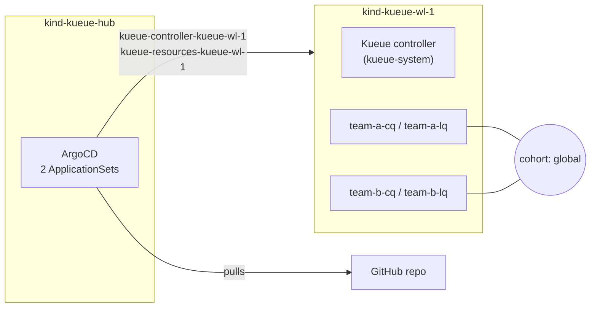
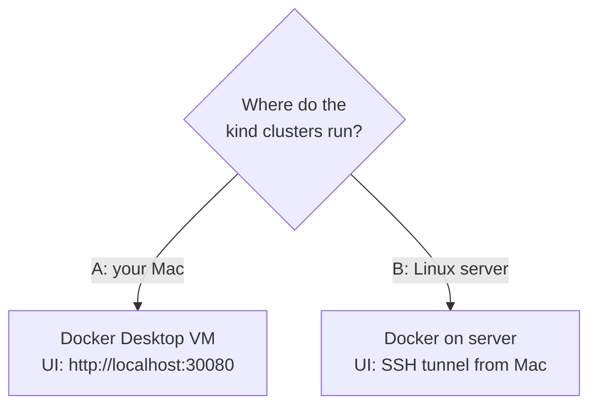

# Kueue via ArgoCD ApplicationSets (single workload cluster)

Replica of the `arene-ai-manifests/kueue-appsets` setup, reduced to one workload cluster for borrowing / lending / preemption experiments between two namespaces (`team-a`, `team-b`).

Runs either **locally on a Mac (Docker Desktop)** or on a **Linux server over SSH from a Mac**. Needs `docker`, `kind`, `kubectl`, `git` on the machine that hosts the clusters. Helm is not needed. See [Where to run](#where-to-run).

## Topology



The hub has no Kueue. In the manifests repo the management cluster does get a Kueue controller, but through an explicit Application (not these ApplicationSets), because its cluster secret lacks `kueue-enabled`. It is not needed for single-cluster experiments, so it is omitted here.

## Mapping to the manifests repo

| manifests repo | here |
|---|---|
| `kueue-appsets/controller/base/values.yaml` | `kueue-appsets/controller/base/values.yaml` |
| `kueue-appsets/resources/charts/kueue-resources` | identical copy |
| `kueue-appsets/resources/base/values.yaml` | identical (cohort `global`, p0..p3 WorkloadPriorityClasses) |
| `resources/overlays/dev/<short-name>/values.yaml` | `resources/overlays/dev/kueue-wl-1/values.yaml` |
| `applicationsets/kueue-controller.yaml` | `argocd/kueue-controller.yaml` |
| `applicationsets/kueue-resources.yaml` | `argocd/kueue-resources.yaml` |
| cluster SealedSecret with labels | Secret created by `setup.sh` with the same labels |

Deliberate differences:

- No `jobset` ApplicationSet, no cert-manager, no ExternalSecret/imagePullSecret (third source dropped from `kueue-controller`). Kueue uses `internalCertManagement`.
- Integrations are only `batch/job` and `pod`.
- Images come from upstream `registry.k8s.io` instead of the Artifactory relay.
- `repoURL` / `targetRevision` are injected into the ApplicationSets by `setup.sh` (`__REPO_URL__`, `__TARGET_REVISION__`) from the current git remote and branch.
- Namespaces `team-a` / `team-b` are created by `setup.sh`, the chart does not create them.
- `fairSharing.enable: true` is kept from the real config. This changes preemption candidate selection in a cohort (fair-share strategies instead of purely classic). Set it to `false` in `kueue-appsets/controller/base/values.yaml` for classic behaviour.

## Resources

Estimates (not measured), for 3 kind nodes (hub control-plane, workload control-plane, workload worker):

| Component | RAM | CPU (steady) |
|---|---|---|
| 3 kind nodes (kubelet, apiserver, etcd, CNI) | ~2.5 to 3 GiB | ~1 to 1.5 |
| ArgoCD (7 pods) | ~1 to 1.5 GiB | ~0.3 |
| Kueue controller | ~0.15 GiB | <0.1 |
| Experiment pods (`sleep`) | negligible actual, but scheduler requests up to 4 CPU / 4Gi at full cohort | |
| **Total** | **~5 to 6 GiB** | **~2 (peak ~4 during setup and image pulls)** |

`setup.sh` refuses to start if Docker has fewer than 4 CPU or 6 GiB. Kind nodes are not individually limited, so the workload node can schedule up to whatever the Docker VM has; the experiments' 4 CPU / 4Gi of requests fit easily.

Disk: ~6 to 8 GiB for node images, ArgoCD and Kueue images.

## Where to run



Both options use the same scripts. In both cases ArgoCD pulls from GitHub, so **commit and push this directory on a branch first** (not `master`) and the clone you run `setup.sh` from must have that branch checked out.

### A. Local on Mac (Docker Desktop)

Your Docker Desktop allocation (12 CPU, 16 GiB, 4 GiB swap, 100 GB disk) is more than enough, and the 24 GiB host leaves ~8 GiB for macOS. Close other heavy containers if you run more than this experiment.

Differences from Linux:

- **Architecture:** Apple Silicon is arm64. Kind node, ArgoCD, Kueue and `busybox` images are all multi-arch, so nothing to change.
- **UI access:** the NodePort is published on `127.0.0.1:30080` of the Mac by Docker Desktop. Open `http://localhost:30080` directly; no tunnel needed.
- **Container IPs are not reachable from macOS.** This does not matter: ArgoCD (in the hub container) reaches the workload API server over the `kind` Docker network via its container IP, and your `kubectl` uses the localhost-mapped ports from the kubeconfig that kind writes.
- **Docker Desktop must be running** with the `kind` network allowed (default).

```bash
cd argocd/06-kueue-appsets-poc
bash setup.sh
open http://localhost:30080     # admin / password printed by setup.sh
```

`kubectl --context kind-kueue-hub|kind-kueue-wl-1` and `experiments/submit.sh` work locally as is.

### B. Linux server over SSH from the Mac

Server needs `docker`, `kind`, `kubectl`, `git`, and >= 4 CPU / 6 GiB free (8 CPU / 8 GiB is comfortable).

Linux-specific points:

- **inotify limits:** two kind clusters on one host often hit "too many open files". Raise them once on the server:

  ```bash
  sudo sysctl fs.inotify.max_user_watches=524288 fs.inotify.max_user_instances=512
  ```

  (persist in `/etc/sysctl.d/` if you want it to survive reboots).
- **Docker access:** the user running `setup.sh` must be in the `docker` group (or use rootless Docker, which kind supports only with extra setup).
- **UI access:** the NodePort is bound to the server's loopback only, so tunnel it:

  ```bash
  # on the Mac
  ssh -L 8080:localhost:30080 <user>@<server>
  open http://localhost:8080
  ```

- Run all `kubectl` commands and `experiments/submit.sh` on the server (kubeconfig lives there). Keep an SSH session (or `tmux`) open for `watch`.

```bash
# on the server
git clone <repo> && cd <repo> && git checkout <your-branch>
cd argocd/06-kueue-appsets-poc
bash setup.sh
```

### Verify (both options)

```bash
kubectl get applications -n argocd --context kind-kueue-hub
# kueue-controller-kueue-wl-1   Synced  Healthy
# kueue-resources-kueue-wl-1    Synced  Healthy

kubectl get clusterqueue,localqueue -A --context kind-kueue-wl-1
kubectl get cohort,resourceflavor,workloadpriorityclass --context kind-kueue-wl-1
```

`kueue-resources` may fail its first syncs until Kueue CRDs and webhook are up; the retry policy handles it.

Teardown: `bash teardown.sh`.

## Experiment setup

Each team: `nominalQuota` 2 CPU / 2Gi, no borrow/lend limits, in cohort `global`. `experiments/submit.sh` creates single-pod Jobs of 500m / 512Mi, so one team fits 4 jobs nominal and 8 jobs fill the cohort. Total node demand at full cohort is 4 CPU / 4Gi.

Both ClusterQueues use `withinClusterQueue: LowerPriority`, `reclaimWithinCohort: Any`, `borrowWithinCohort: LowerPriority` (threshold 100000, the chart default).

```bash
export CTX=kind-kueue-wl-1
watch -n2 "kubectl get workloads -A --context $CTX; echo; kubectl get clusterqueue --context $CTX"
```

### 1. Borrowing

```bash
./experiments/submit.sh team-a 8 p3-batch
```

4 workloads admitted on nominal quota, 4 more admitted by borrowing team-b's idle quota. Check `kubectl get clusterqueue team-a-cq -o yaml` -> `status.flavorsUsage[].resources[].borrowed`.

### 2. Reclaim (preemption across CQs)

With experiment 1 still running:

```bash
./experiments/submit.sh team-b 4 p3-batch
```

team-b is within its nominal quota, so Kueue preempts team-a's borrowing workloads (`reclaimWithinCohort: Any`) and admits team-b's. Look for `Preempted` / `Evicted` conditions on the team-a workloads and events in `team-a`.

### 3. Priority preemption within a ClusterQueue

```bash
./experiments/submit.sh team-a 4 p3-batch
./experiments/submit.sh team-a 2 p1-urgent
```

(Run on a clean queue, or with team-b also full so there is nothing to borrow.) p1-urgent preempts p3-batch inside `team-a-cq` (`withinClusterQueue: LowerPriority`). To disable, set `withinClusterQueue: Never` in the overlay and push.

### 4. Borrowing with preemption (`borrowWithinCohort`)

Fill team-b with `p3-batch` (4 jobs) and team-a with 4 `p3-batch`, then submit `p1-urgent` jobs to team-a. With `borrowWithinCohort: LowerPriority`, team-a may preempt lower-priority workloads in team-b to borrow. Priorities above the threshold (`p0-realtime` = 1000000 > 100000) are not preempted this way.

### 5. Lending and borrowing limits (GitOps change)

Uncomment `lendingLimit` / `borrowingLimit` lines in `kueue-appsets/resources/overlays/dev/kueue-wl-1/values.yaml`, push, and watch `kueue-resources-kueue-wl-1` sync (or click Refresh in the UI):

- `lendingLimit: "1"` on team-b: team-a can borrow at most 1 CPU from team-b, so at most 6 team-a workloads run at once (2 nominal + 1 CPU borrowed); the rest of team-b's quota is protected.
- `borrowingLimit: "1"` on team-a: team-a caps at 2 + 1 CPU.

### Cleaning jobs between runs

```bash
kubectl delete jobs --all -n team-a --context kind-kueue-wl-1
kubectl delete jobs --all -n team-b --context kind-kueue-wl-1
```

## Notes

- Priority only orders admission; it does not itself interrupt running workloads. Preemption happens via the `preemption` settings above.
- The kind worker node must have room for admitted pods. Docker host should have at least 4 CPU free; otherwise pods stay `Pending` while workloads are already admitted.
- If you change the branch or repo, re-run `setup.sh` (or edit the ApplicationSets on the hub) so `targetRevision` follows.
