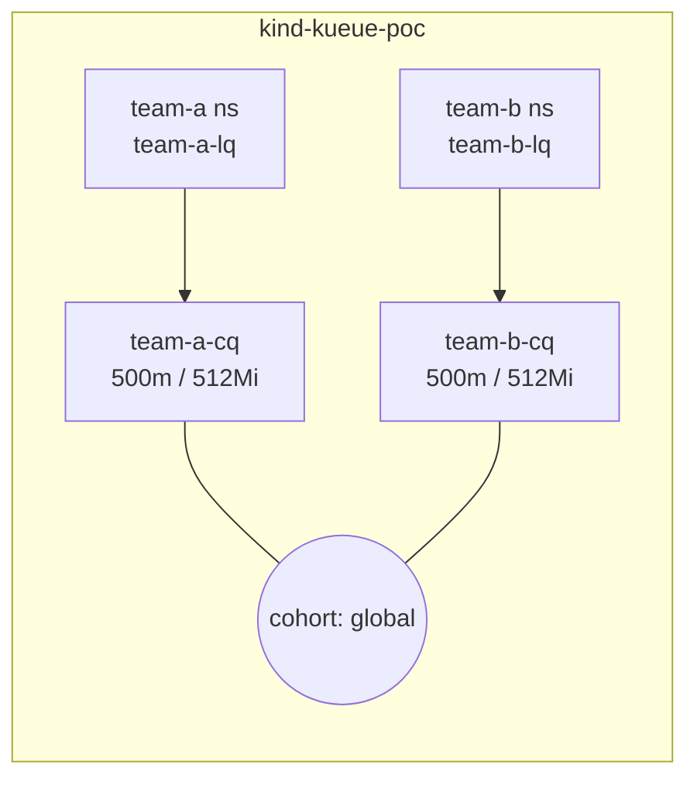

# Kueue borrowing / lending / preemption on one cluster

Single Kind cluster, Kueue only (no MultiKueue, no ArgoCD). Two namespaces (`team-a`, `team-b`), one ClusterQueue each, both in cohort `global`. Same `kueue-resources` chart and values schema as experiment 06, installed with Helm. Needs `docker`, `kind`, `kubectl`, `helm`.



```bash
bash setup.sh      # cluster + Kueue chart (version from kueue/controller/values.yaml) + kueue-resources chart; re-run to apply config changes
bash teardown.sh
```

## Where to change config

Main file: `kueue/resources/overlays/dev/kueue-poc/values.yaml` (same schema as 06).

| What | Where |
|---|---|
| Quotas (`nominalQuota`), `borrowingLimit`, `lendingLimit` | overlay values, `clusterSetConfigs.kueue-poc.clusterQueues.<cq>.resourceGroups` (limits are commented out) |
| Preemption (`reclaimWithinCohort`, `withinClusterQueue`, `borrowWithinCohort.policy` / `maxPriorityThreshold`) | overlay values, `...clusterQueues.<cq>.preemption` |
| Cohort membership | overlay values, `...clusterQueues.<cq>.cohort` |
| Cohorts, priority class values | `kueue/resources/base/values.yaml` |
| Fair sharing, Kueue config, Kueue version | `kueue/controller/values.yaml` (`fairSharing`, `kueueVersion`); then `bash setup.sh` |
| Job size, count, priority, sleep | `experiments/submit.sh` (cpu/memory in the Job template, currently 125m / 128Mi; args for count, priority, sleep) |

Apply changes: re-run `bash setup.sh` (idempotent; upgrades both Helm releases and restarts the Kueue controller).

## Experiment setup

Each team: `nominalQuota` 500m CPU / 512Mi, no borrow/lend limits, cohort `global`. `experiments/submit.sh` creates single-pod Jobs requesting and limited to 125m CPU / 128Mi, so one team fits 4 jobs nominal (4 x 125m = 500m, 4 x 128Mi = 512Mi) and 8 jobs fill the cohort (1 CPU / 1Gi).

Both ClusterQueues start with `reclaimWithinCohort: Any`, `withinClusterQueue: LowerPriority`, `borrowWithinCohort: LowerPriority` (threshold 100000). Fair sharing is off.

```bash
export CTX=kind-kueue-poc
watch -n2 "kubectl get workloads -A --context $CTX; echo; kubectl get clusterqueue --context $CTX"

./experiments/submit.sh <team-a|team-b> <count> [priority-class] [sleep-seconds]
# priority-class: p0-realtime | p1-urgent | p2-research | p3-batch (default p2-research)
```

Run every experiment from a clean state (see [Cleaning](#cleaning-between-runs)). A config change means editing the overlay values and re-running `bash setup.sh`; revert the edit afterwards.

Useful checks:

```bash
# per-CQ usage and how much is borrowed
kubectl get cq team-a-cq --context $CTX -o jsonpath='{.status.flavorsUsage}'; echo
# why a workload is pending / evicted
kubectl describe workload -n team-a --context $CTX | grep -A3 -i "evicted\|preempt\|QuotaReserved"
kubectl get events -n team-a --context $CTX --sort-by=.lastTimestamp | tail
```

Evicted workloads are not deleted: they go back to the queue (`Admitted: False`, `Evicted: True`) and wait for quota.

### 1. Borrowing

```bash
./experiments/submit.sh team-a 8 p3-batch
```

team-a admits 4 jobs on its nominal quota and 4 more by borrowing team-b's idle quota. `flavorsUsage` on `team-a-cq` shows CPU `total: 1`, `borrowed: 500m`. A 9th job would stay pending: the cohort is full.

### 2. Reclaim (preemption across ClusterQueues)

With experiment 1 still running:

```bash
./experiments/submit.sh team-b 4 p3-batch
```

team-b is within its nominal quota, so `reclaimWithinCohort: Any` lets it evict team-a's borrowing workloads, even at equal priority. team-a drops to 4 admitted (nominal), 4 go back to pending; team-b gets 4 admitted. Look for `Preempted` events in `team-a`.

### 3. Priority preemption within a ClusterQueue

```bash
./experiments/submit.sh team-b 4 p3-batch
./experiments/submit.sh team-a 4 p3-batch
./experiments/submit.sh team-a 2 p1-urgent
```

Both queues sit exactly at nominal, so nothing can be borrowed. `withinClusterQueue: LowerPriority` makes the 2 `p1-urgent` jobs evict 2 of team-a's `p3-batch` jobs. team-b is untouched. Set `withinClusterQueue: Never` on team-a and redo: the urgent jobs stay pending.

### 4. Nominal quota is protected from borrowers

```bash
./experiments/submit.sh team-b 4 p3-batch
./experiments/submit.sh team-a 4 p1-urgent
./experiments/submit.sh team-a 2 p1-urgent
```

team-a is at nominal and wants 2 more jobs, higher priority than team-b's. It still cannot preempt team-b: team-b is not borrowing, so it has no workloads eligible for preemption. The 2 extra jobs stay pending; the scheduler logs `Workload requires preemption, but there are no candidate workloads allowed for preemption`:

```bash
kubectl logs -n kueue-system deploy/kueue-controller-manager --context $CTX | grep "no candidate"
```

`borrowWithinCohort` only applies against ClusterQueues that are over their nominal quota. With two queues and no spare cohort capacity, a borrowing preemptor cannot find such a queue (the other side is by definition under nominal), so this knob has no visible effect in this setup. It needs a third queue or cohort-level quota to demonstrate.

### 5. Lending limit

Uncomment in the overlay values, under `team-b-cq`: `lendingLimit: 250m` (cpu) and `lendingLimit: 256Mi` (memory). Then `bash setup.sh` and rerun experiment 1.

team-b lends at most 250m of its 500m, so team-a tops out at 500m + 250m = 750m (6 x 125m): 6 admitted, 2 pending (`team-a-cq` shows `total: 750m`, `borrowed: 250m`). team-b's remaining 250m (2 jobs) is always available to it.

### 6. Borrowing limit

Uncomment `borrowingLimit: 250m` (cpu) and `borrowingLimit: 256Mi` (memory) under `team-a-cq`, `bash setup.sh`, then:

```bash
./experiments/submit.sh team-a 8 p3-batch
```

team-a caps at 500m + 250m = 750m: 6 admitted, 2 pending, even though team-b is completely idle.

### 7. Reclaim policy

Set `reclaimWithinCohort: LowerPriority` under `team-b-cq`, `bash setup.sh`, then:

```bash
./experiments/submit.sh team-a 8 p3-batch      # 4 borrowed from team-b
./experiments/submit.sh team-b 4 p3-batch      # same priority: cannot reclaim, stays pending
./experiments/submit.sh team-b 2 p2-research   # higher priority: evicts 2 of team-a's borrowing jobs
```

With `Any` (experiment 2) the `p3-batch` jobs would have reclaimed immediately. With `Never`, nothing is reclaimed until team-a's jobs finish.

### 8. Fair sharing

In `kueue/controller/values.yaml` uncomment the `fairSharing` block (v1beta2 config has no `enable` flag; the block's presence turns it on), then `bash setup.sh` (restarts the controller) and redo experiments 1 and 2. In this setup the outcome was the same as classic for 1 and 2 (team-a 4 / team-b 4 after reclaim). `fairSharing.preemptionStrategies` is configurable in the same file; differences are more likely with more than two queues or unequal weights. `borrowWithinCohort` cannot be combined with fair sharing.

### Cleaning between runs

```bash
kubectl delete jobs --all -n team-a --context $CTX
kubectl delete jobs --all -n team-b --context $CTX
```

## Notes

- Priority orders admission within a queue; it only interrupts running workloads through the `preemption` settings.
- Preemption runs at the Kueue level: Kueue suspends the Job and its pod is deleted. Evicted Jobs are resumed automatically when quota frees up.
- Admitted pods need node capacity: a full cohort is 8 pods x 125m = 1 CPU / 1Gi, which any Docker VM fits. If pods stay `Pending` while workloads are admitted, the node is out of capacity.
- Experiments 1 to 8 were run against Kueue 0.19.0 (re-verified on 0.20.7: setup, experiments 1 and 2 only) and the outcomes above observed (8: only experiments 1 and 2). The `withinClusterQueue: Never` variant in 3 was not run.
