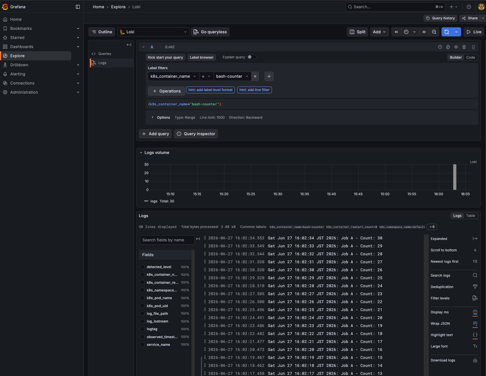

# 01 - Collect & Export Logs with OpenTelemetry

Collect Kubernetes pod logs using an OTel Collector daemonset, ship them to Loki, and visualize in Grafana.

## Stack

- **kind** - local k8s cluster
- **OTel Collector** (daemonset) - collects pod logs via `logsCollection` preset, exports via OTLP HTTP
- **Loki** - log storage (single binary, filesystem, no auth)
- **Grafana** - visualization, pre-wired to Loki

## How it works

1. OTel Collector runs as a daemonset on every node, tailing container logs from the node filesystem
2. Logs are forwarded to Loki via `otlphttp` exporter
3. A sample `counter-job` emits 30 lines of output — used to verify the pipeline

## Run it

**1. Create the cluster**
```bash
kind create cluster --config kind.yaml
```

**2. Install cert-manager**
```bash
helm install \
  cert-manager oci://quay.io/jetstack/charts/cert-manager \
  --version v1.20.2 \
  --namespace cert-manager \
  --create-namespace \
  --set crds.enabled=true

kubectl wait deploy/cert-manager -n cert-manager --for=condition=available --timeout=5m
kubectl wait deploy/cert-manager-cainjector -n cert-manager --for=condition=available --timeout=5m
kubectl wait deploy/cert-manager-webhook -n cert-manager --for=condition=available --timeout=5m
```

**3. Install Loki**
```bash
helm repo add grafana https://grafana.github.io/helm-charts && helm repo update

helm install loki grafana/loki \
  --namespace monitoring \
  --create-namespace \
  --set deploymentMode=SingleBinary \
  --set loki.auth_enabled=false \
  --set loki.useTestSchema=true \
  --set singleBinary.replicas=1 \
  --set loki.commonConfig.replication_factor=1 \
  --set loki.storage.type=filesystem \
  --set minio.enabled=false \
  --set backend.replicas=0 \
  --set read.replicas=0 \
  --set write.replicas=0

kubectl wait pod -l app.kubernetes.io/name=loki -n monitoring --for=condition=ready --timeout=5m
```

**4. Install Grafana**
```bash
helm install grafana grafana/grafana \
  --namespace monitoring \
  --set adminPassword=admin \
  --set service.type=NodePort \
  --set service.nodePort=30000 \
  --set "datasources.datasources\.yaml.apiVersion=1" \
  --set "datasources.datasources\.yaml.datasources[0].name=Loki" \
  --set "datasources.datasources\.yaml.datasources[0].type=loki" \
  --set "datasources.datasources\.yaml.datasources[0].url=http://loki-gateway.monitoring.svc.cluster.local" \
  --set "datasources.datasources\.yaml.datasources[0].access=proxy" \
  --set "datasources.datasources\.yaml.datasources[0].isDefault=true"

kubectl wait pod -l app.kubernetes.io/name=grafana -n monitoring --for=condition=ready --timeout=5m
```

**5. Install & Configure OTel Collector**
```bash
helm repo add open-telemetry https://open-telemetry.github.io/opentelemetry-helm-charts
helm install my-opentelemetry-collector open-telemetry/opentelemetry-collector \
   --set image.repository="otel/opentelemetry-collector-k8s" \
   --set mode=daemonset \
   -f values.yaml
```

## Verify

Open Grafana at `http://localhost:30000` (admin/admin), go to **Explore → Loki** and run:

```
{k8s_container_name="bash-counter"}
```


